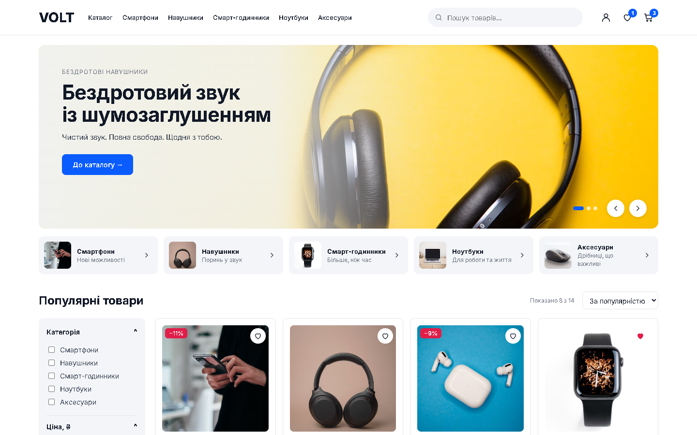
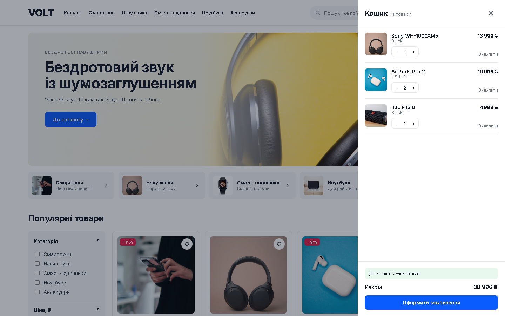

# VOLT — інтернет-магазин електроніки

Фронтенд магазину електроніки на React + Vite.



| Кошик | Мобільна версія |
| --- | --- |
|  |  |

## Що реалізовано

- Слайдер на головній з автопрокруткою (пауза при наведенні)
- Каталог: фільтри за категорією, брендом, ціною і наявністю; пошук; сортування; кнопка «Показати ще»
- Картка товару: знижка, кількість, обране, стан «Немає в наявності»
- Кошик у бічній панелі: зміна кількості з обмеженням по залишку, підказка до безкоштовної доставки
- Оформлення замовлення: валідація імені й телефону, способи доставки (відділення / кур'єр / самовивіз), підсумок
- Кошик, обране та історія замовлень зберігаються в `localStorage`
- Адаптивна верстка

## Стек

React 18, Vite, звичайний CSS (без UI-бібліотек).

## Запуск

```bash
npm install
npm run dev
```

Збірка: `npm run build`, результат у `dist/`.

## Структура

```
src/
  App.jsx                 — сторінка: фільтрація, сортування, пагінація
  context/ShopContext.jsx — кошик і обране
  data/products.js        — каталог (у реальному проєкті — API)
  components/             — Header, HeroSlider, Filters, ProductCard, CartDrawer, Checkout
  hooks/useLocalStorage.js
  utils/format.js         — ціни та відмінювання слів
```

Фото товарів — Unsplash, ціни умовні.
